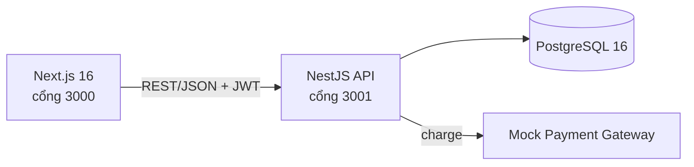

# BrewLite

[](https://github.com/khoadangtran141006-svg/Software-Engineering/actions/workflows/ci.yml)

Ứng dụng web đặt đồ uống **không dùng tiền mặt**, làm cho đồ án môn Công nghệ Phần mềm (Đại học Sài Gòn, học kỳ I 2026–2027) theo quy trình Agile Scrum. Luồng chính: xem menu → chọn size/topping → giỏ hàng → đăng nhập → thanh toán → xác nhận → lịch sử đơn.

<!-- Thêm ảnh/GIF demo vào docs/images rồi bỏ ghi chú ở đây, ví dụ:  -->

## Tính năng

- Menu, chi tiết sản phẩm, chọn size và topping; giỏ hàng lưu khi tải lại trang và **không cho vượt tồn kho**.
- Đăng ký, đăng nhập (JWT, bcrypt), quên mật khẩu; chặn email gõ sai tên miền phổ biến (ví dụ `gmail.co`).
- Thanh toán mô phỏng: **Ví điện tử** (MoMo, ZaloPay, ShopeePay, xác nhận OTP), **Thẻ ngân hàng** (16–19 chữ số), **QR Code**.
- **Thanh toán idempotent** bằng `Idempotency-Key`: gửi lặp hoặc gửi đồng thời không tạo hai giao dịch.
- **Máy trạng thái đơn hàng** (PENDING → PAID → PREPARING → READY → COMPLETED, cùng PAYMENT_FAILED và CANCELLED).
- **Không bán quá tồn kho** khi đặt đồng thời; khách tự hủy đơn chưa thanh toán, đơn quá hạn tự hủy và hoàn kho.
- Mã khuyến mãi và điểm thưởng.

## Kiến trúc



Sơ đồ chi tiết (mô hình dữ liệu, máy trạng thái, luồng thanh toán idempotent, quyết định thiết kế): [docs/architecture.md](docs/architecture.md).

| Thành phần | Công nghệ |
|---|---|
| Frontend | Next.js (React, TypeScript), TailwindCSS, Zustand |
| Backend | NestJS, class-validator, JWT (Passport), bcrypt |
| CSDL | PostgreSQL 16 (TypeORM + Prisma) |
| DevOps | Docker Compose, GitHub Actions |

## Chạy bằng Docker Compose

1. Sao chép `.env.example` thành `.env` ở thư mục gốc. Đổi `DB_PASSWORD` và `JWT_SECRET` thành giá trị riêng.
2. Chạy `docker compose up --build`.
3. Mở giao diện tại `http://localhost:3000`; API tại `http://localhost:3001`.

PostgreSQL được lưu trong volume `brewlite-data`. Backend tự áp dụng migration và nạp dữ liệu sản phẩm mẫu (5 món) khi khởi động.

### Biến môi trường chính

| Biến | Ý nghĩa |
|---|---|
| `DB_PASSWORD`, `JWT_SECRET` | Bắt buộc, tự đặt giá trị riêng |
| `NEXT_PUBLIC_API_URL` | Địa chỉ API cho frontend (mặc định `http://localhost:3001`) |
| `STAFF_EMAIL`, `STAFF_PASSWORD` | Tạo sẵn tài khoản barista để demo (để trống nếu không cần) |
| `ORDER_EXPIRY_MINUTES` | Đơn chưa thanh toán tự hủy sau số phút này (mặc định 15, `0` để tắt) |
| `SMTP_*` | Gửi email quên mật khẩu; bắt buộc ở production |

## Chạy để phát triển

Yêu cầu Node.js 22+ và PostgreSQL 16+.

1. Tạo database `brewlite_db`; sao chép `backend/.env.example` thành `backend/.env`, điền thông tin kết nối và đặt `JWT_SECRET` đủ dài.
2. Trong `backend`: `npm ci`, `npm run db:migrate`, `npm run db:seed`, `npm run start:dev`.
3. Trong `frontend`: tạo `.env.local` với `NEXT_PUBLIC_API_URL=http://localhost:3001`, rồi `npm ci`, `npm run dev`.

## API chính

| Endpoint | Chức năng | Xác thực |
|---|---|---|
| `GET /products`, `GET /products/:id` | Menu, chi tiết | Không |
| `POST /auth/register`, `POST /auth/login` | Đăng ký, đăng nhập (trả JWT) | Không |
| `GET /auth/me` | Thông tin tài khoản và điểm thưởng | Bearer |
| `POST /auth/forgot-password`, `POST /auth/reset-password` | Quên và đặt lại mật khẩu | Không |
| `POST /orders` | Tạo đơn (PENDING), giữ chỗ tồn kho | Bearer |
| `GET /orders/me` | Lịch sử đơn của người dùng | Bearer |
| `PATCH /orders/:id/cancel` | Khách hủy đơn chưa thanh toán | Bearer |
| `PATCH /orders/:id/status` | Cập nhật trạng thái đơn | Bearer, STAFF |
| `POST /payments` | Thanh toán (header `Idempotency-Key`) | Bearer |
| `GET /promotions/validate?code=&subtotal=` | Xem trước số tiền giảm | Không |

### Quy tắc dữ liệu thanh toán (backend kiểm tra lại, không chỉ frontend)

- **Thẻ ngân hàng:** `cardNumber` gồm 16–19 chữ số.
- **Ví điện tử:** `walletProvider` (MoMo / ZaloPay / ShopeePay), `walletPhone` (số di động Việt Nam 10 số) và `otp` 6 chữ số.
- **QR Code:** `token` mô phỏng.

### Dữ liệu thử

| Mục | Giá trị |
|---|---|
| Mã khuyến mãi | `BREW10` (giảm 10%) |
| Điểm thưởng | 1 điểm cho mỗi 10.000đ sau giảm, cộng khi đơn PAID |
| Thẻ thành công / bị từ chối | `4242424242424242` / `4000000000000002` |
| OTP ví thành công | `123456` (mã khác bị từ chối) |

## Hủy đơn, đơn quá hạn và tài khoản barista

Tồn kho bị trừ ngay khi tạo đơn. Khách hủy được đơn PENDING hoặc PAYMENT_FAILED của mình; đơn chưa thanh toán quá `ORDER_EXPIRY_MINUTES` tự hủy và hoàn kho. Đơn đã PAID cần nhân viên xử lý.

Đặt `STAFF_EMAIL` và `STAFF_PASSWORD` trong `.env` để có tài khoản STAFF. Đăng nhập bằng `POST /auth/login`, rồi gọi `PATCH /orders/:id/status` với `{ "status": "PREPARING" }` (lần lượt `PREPARING` → `READY` → `COMPLETED`). Chuyển trạng thái sai bị từ chối với lỗi 400. Lệnh mẫu: [docs/demo-script.md](docs/demo-script.md).

## Kiểm thử

```bash
cd backend && npm test && npm run test:e2e && npm run build
cd frontend && npm run build
```

`test/business.e2e-spec.ts` là integration test chạy trên **PostgreSQL thật** để chứng minh Task 10 (chặn chuyển trạng thái sai, Idempotency-Key kể cả gửi đồng thời, không vượt tồn kho khi đặt đồng thời, hoàn kho, khuyến mãi và điểm thưởng). Test dùng database riêng `brewlite_test` (cấu hình bằng `TEST_DB_*`) và **xóa sạch schema của database đó mỗi lần chạy**. Chi tiết và ma trận truy vết tiêu chí chấp nhận → kiểm thử: [docs/testing.md](docs/testing.md).

## Tài liệu dự án

| Tài liệu | Nội dung |
|---|---|
| [docs/product-backlog.md](docs/product-backlog.md) | Product Vision, user story, tiêu chí chấp nhận, DoD, backlog phiên bản sau |
| [docs/sprint-plan.md](docs/sprint-plan.md) | Kế hoạch Sprint và tiến độ thực tế theo Git, mẫu Planning và Daily Scrum |
| [docs/burndown.md](docs/burndown.md) | Burndown theo mốc giao và mẫu burndown hằng ngày |
| [docs/retrospective.md](docs/retrospective.md) | Retrospective, phản hồi của người kiểm thử, bài học |
| [docs/architecture.md](docs/architecture.md) | Sơ đồ kiến trúc, ERD, máy trạng thái, luồng thanh toán, quyết định thiết kế |
| [docs/testing.md](docs/testing.md) | Chiến lược kiểm thử và ma trận truy vết |
| [docs/demo-script.md](docs/demo-script.md) | Kịch bản demo và lệnh đo thời gian phản hồi |
| [docs/release-notes.md](docs/release-notes.md) | Tính năng, hạn chế đã biết của v1.0.0 |

## Ghi chú

Backend dùng TypeORM cho tài khoản/đơn/thanh toán và Prisma migration cho bảng sản phẩm (nợ kỹ thuật đã ghi trong backlog). Không đưa `.env`, mật khẩu thật hoặc JWT secret vào Git. Cổng thanh toán là mô phỏng, không trừ tiền thật.
