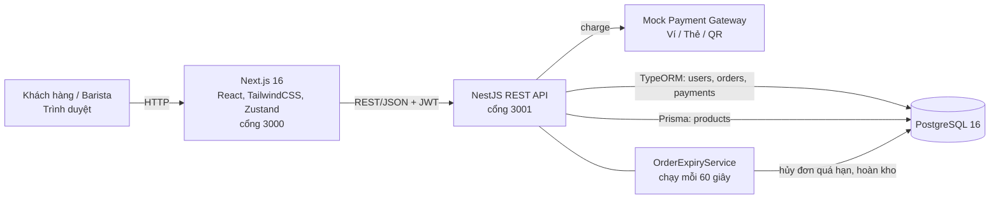
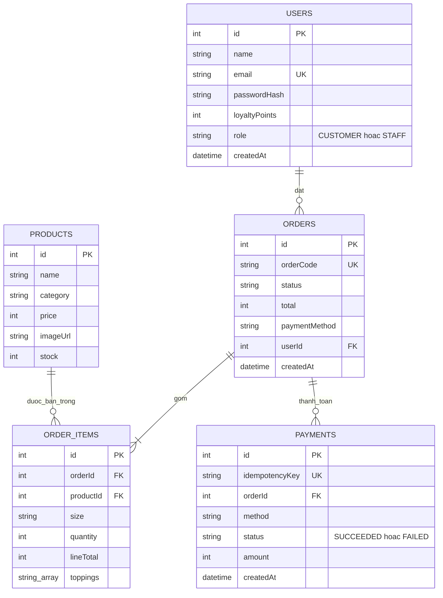
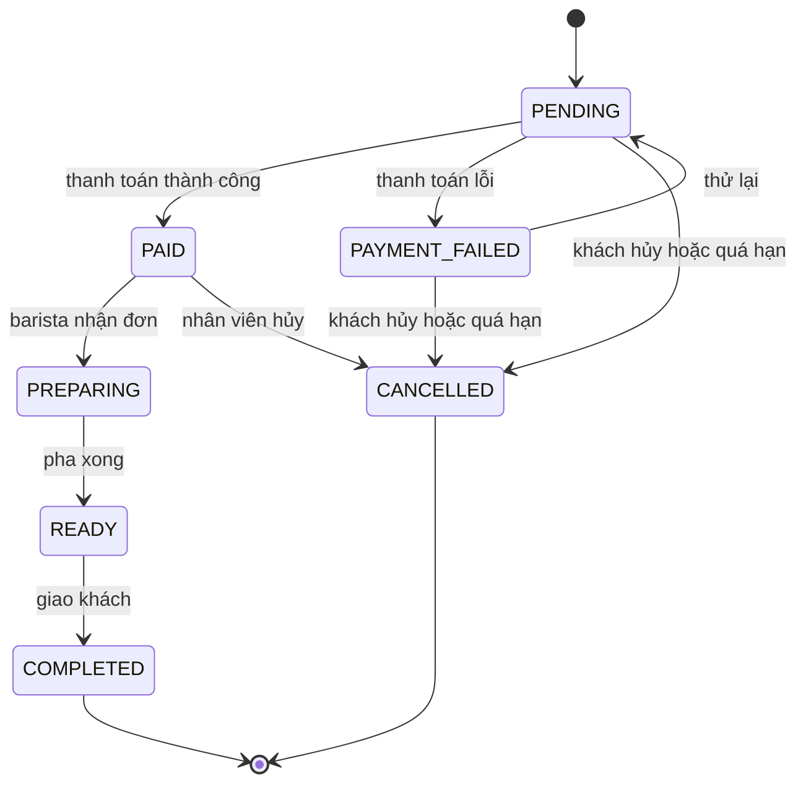
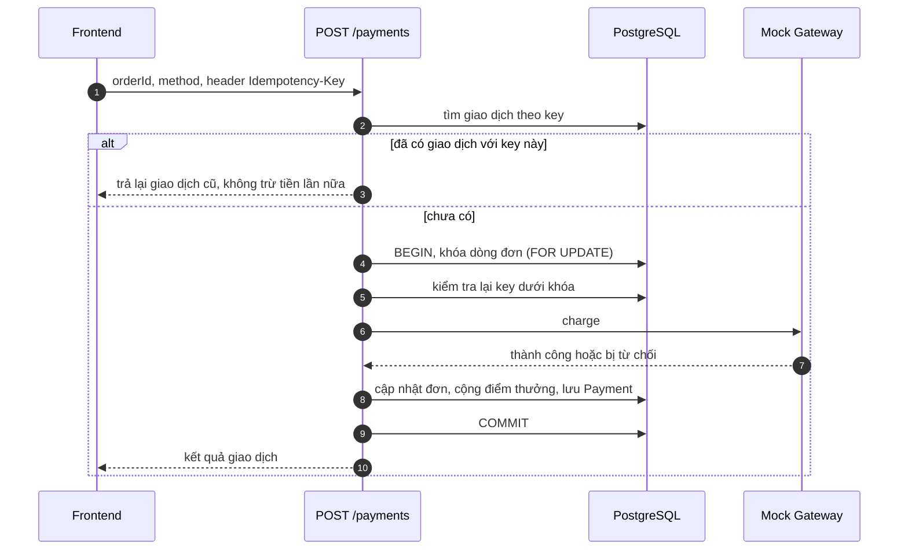

# Kiến trúc và thiết kế

## 1. Tổng quan thành phần



| Thành phần | Công nghệ |
|---|---|
| Frontend | Next.js (React, TypeScript), TailwindCSS, Zustand (giỏ hàng, lịch sử đơn) |
| Backend | NestJS (TypeScript), REST, class-validator, JWT (Passport), bcrypt |
| CSDL | PostgreSQL 16; TypeORM cho tài khoản/đơn/thanh toán, Prisma (migration + seed) cho sản phẩm |
| Thanh toán | Mock Payment Service mô phỏng Ví (OTP) / Thẻ / QR |
| DevOps | Docker Compose (3 dịch vụ), GitHub Actions CI |

## 2. Mô hình dữ liệu

`Order.total` là số tiền **sau giảm giá**; mã giảm giá chỉ ảnh hưởng đến `total` chứ không lưu thành cột riêng.



## 3. Máy trạng thái đơn hàng

Mọi chuyển trạng thái đi qua `OrderStateService.assertTransition`; chuyển không có mũi tên sẽ bị từ chối (HTTP 400). COMPLETED và CANCELLED là trạng thái kết thúc.



## 4. Thanh toán idempotent



## 5. Quyết định thiết kế quan trọng

### 5.1 Chống bán quá tồn kho (kiểm soát đồng thời lạc quan)
Đề yêu cầu "transaction + optimistic locking". BrewLite dùng **cập nhật có điều kiện nguyên tử** trong transaction:

```sql
UPDATE products SET stock = stock - :quantity WHERE id = :id AND stock >= :quantity
```

Không giữ khóa trong lúc xử lý; nếu có xung đột thì câu lệnh không cập nhật dòng nào (`affected = 0`) và backend từ chối đơn với thông báo hết hàng. Đây là một dạng kiểm soát đồng thời lạc quan (phát hiện xung đột lúc ghi, không khóa trước) và cho kết quả đúng mà không cần cột `version`. Bằng chứng: test "10 đơn cùng lúc khi kho còn 5 thì đúng 5 đơn thành công" chạy trên PostgreSQL thật.

### 5.2 Khóa đơn khi thanh toán và hủy
Thanh toán, hủy đơn và dọn đơn quá hạn đều khóa dòng đơn (`FOR UPDATE`) rồi **kiểm tra lại trạng thái dưới khóa**. Nhờ đó hai request song song cùng key, hai key khác nhau cho cùng một đơn, hoặc "hủy cùng lúc thanh toán" đều cho kết quả nhất quán.

### 5.3 Giữ chỗ tồn kho và đơn quá hạn
Tồn kho bị trừ lúc tạo đơn. Đơn chưa thanh toán được hoàn kho khi khách hủy hoặc sau `ORDER_EXPIRY_MINUTES` (mặc định 15). Mốc quá hạn được tính bằng **đồng hồ của cơ sở dữ liệu**, cùng nguồn với `createdAt`, để lệch giờ giữa máy chạy ứng dụng và Docker không làm hủy nhầm.

### 5.4 Tính tiền ở server
Backend tự tính giá theo sản phẩm, size, topping và mã giảm giá; không tin giá do frontend gửi.

### 5.5 Hai ORM
TypeORM quản lý tài khoản, đơn, thanh toán (hiện bật `synchronize`); Prisma quản lý migration và seed bảng sản phẩm. Đây là nợ kỹ thuật đã ghi trong [product-backlog.md](product-backlog.md) (mục 6).

### 5.6 Bảo mật cơ bản
Mật khẩu băm bằng bcrypt; JWT có chữ ký từ biến môi trường `JWT_SECRET`; dữ liệu đầu vào được kiểm tra bằng `class-validator` (bật `whitelist` và `forbidNonWhitelisted`); chỉ STAFF được đổi trạng thái đơn; ở production quên mật khẩu bắt buộc cấu hình SMTP.
