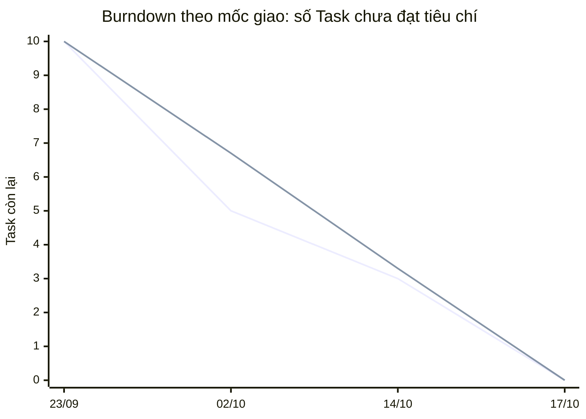
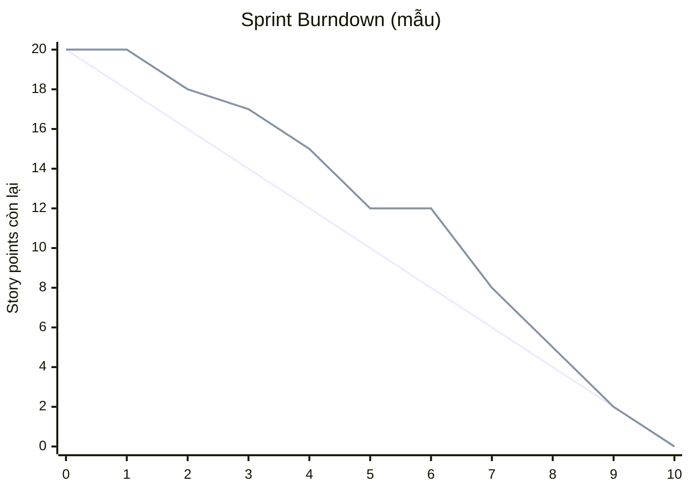

# Burndown

Burndown chart theo dõi khối lượng công việc còn lại giảm dần theo thời gian. Đường **lý tưởng** giảm đều; đường **thực tế** phản ánh tiến độ thật. Thực tế nằm trên lý tưởng nghĩa là đang chậm; nằm dưới nghĩa là vượt tiến độ.

## 1. Burndown thực tế của bản cá nhân (theo mốc giao)

**Quy ước:** mỗi Task trong đề tương đương 1 điểm. "Còn lại" là số Task **chưa đạt đầy đủ tiêu chí chấp nhận** của đề tại mốc đó.

> Đây là burndown **theo mốc giao**, không phải theo từng ngày, vì bản cá nhân không ghi số liệu hằng ngày. Dữ liệu lấy từ lịch sử Git và lần rà soát đối chiếu tiêu chí ngày 14/10.

| Mốc | Ngày | Còn lại (thực tế) | Còn lại (lý tưởng) | Căn cứ |
|---|---|---|---|---|
| Khởi tạo | 23/09 | 10 | 10 | Initial commit |
| Giao 1 | 02/10 | 5 | 6,7 | Task 1–5 hoàn thành |
| Rà soát theo PDF | 14/10 | 3 | 3,3 | Task 6, 7 đạt; Task 8 (thiếu thẻ), 9 (chưa chạy được Docker/demo), 10 (test chỉ dùng mock, thiếu UI khuyến mãi) chưa đủ |
| Giao 3 | 17/10 | 0 | 0 | PR #1, #2, #3: Task 8, 9, 10 đạt đủ tiêu chí |

Đường thứ nhất là **thực tế** (10, 5, 3, 0); đường thứ hai là **lý tưởng** (10, 6,7, 3,3, 0).

## 2. Mẫu burndown hằng ngày cho Sprint của nhóm

Sprint 2 tuần = 10 ngày làm việc. Ví dụ Sprint 20 điểm thì đường lý tưởng giảm 2 điểm mỗi ngày. Cuối mỗi ngày, điền số điểm còn lại thật vào cột "Thực tế":

| Ngày làm việc | Lý tưởng | Thực tế |
|---|---|---|
| 0 | 20 | 20 |
| 1 | 18 | |
| 2 | 16 | |
| 3 | 14 | |
| 4 | 12 | |
| 5 | 10 | |
| 6 | 8 | |
| 7 | 6 | |
| 8 | 4 | |
| 9 | 2 | |
| 10 | 0 | |

Sau khi có số liệu, thay vào biểu đồ bên dưới (sửa dãy `line` thứ hai):

> Các số của đường thứ hai trong biểu đồ mẫu này chỉ là **ví dụ minh họa**, không phải số liệu của dự án. Hãy thay bằng số thật của nhóm.
